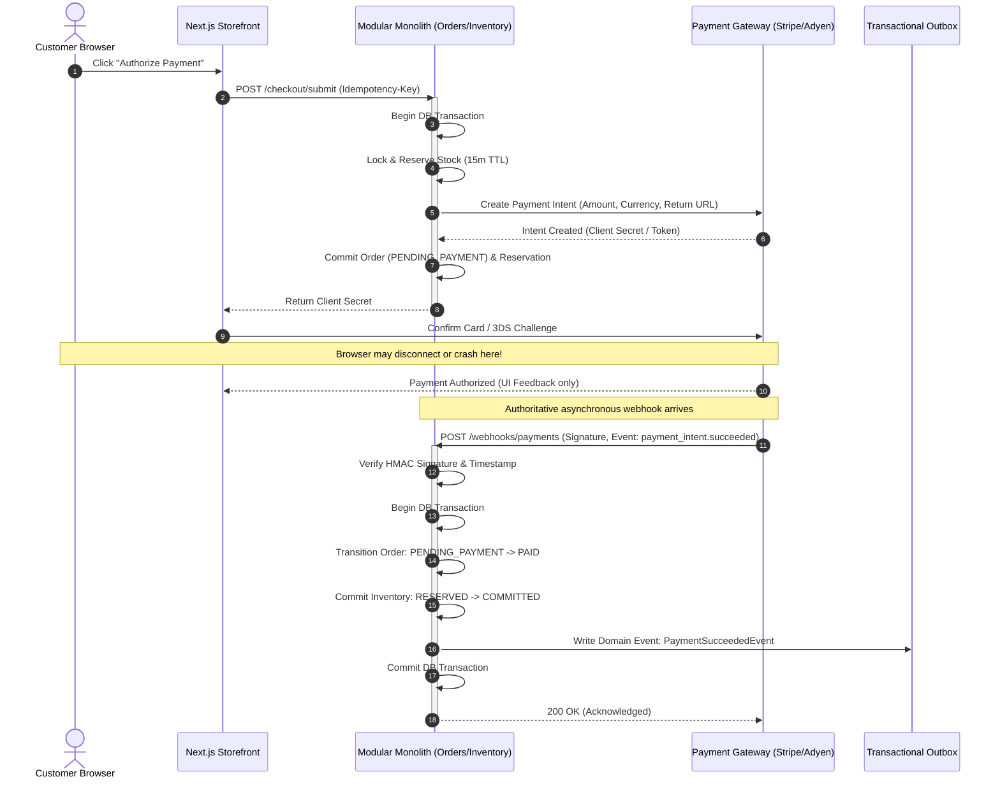
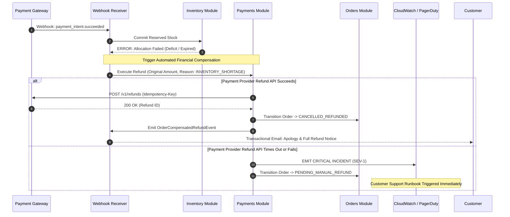
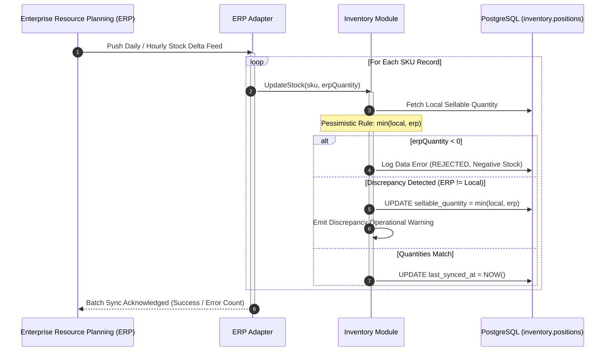

# Integration Design Specification

**Version:** 2.0  
**Status:** Architecture Baseline

---

## 1. Checkout, Payment Webhook & Asynchronous Commit Flow

This sequence illustrates checkout submission, client-side tokenization, 15-minute stock reservation, and browser-disconnect recovery via the payment webhook (`FR-ORD-001`, `FR-INV-002`).

---

## 2. Automated Compensation Workflow (`FR-INV-003`)

If an unexpected deficit occurs post-payment (e.g. physical warehouse loss or rare lock collision), the system automatically refunds the charge without human delay.

---

## 3. ERP Pessimistic Inventory Synchronization (`FR-INV-001`)

---

## 4. Integration Fault Model & Resiliency Matrix

| External Integration | Protocol | Auth Mechanism | Timeout | Retry Policy | Fallback / Failure Action |
| :--- | :--- | :--- | :--- | :--- | :--- |
| **Payment Gateway API** | HTTPS / REST | Bearer API Key in Secrets Mgr | 5,000ms | 3x with Exponential Backoff (Idempotency Key preserved) | Escalate to High-Priority Incident if compensation fails. |
| **Payment Webhook** | HTTPS / Ingress | Raw HMAC-SHA256 Signature + Timestamp | 3,000ms | Provider retries automatically on 5xx | Provider replay detection; return 200 OK if event ID is already processed. |
| **Logistics Carrier API** | HTTPS / REST | OAuth2 Client Credentials | 10,000ms | 3x with Exponential Backoff | Queue dispatch job in Outbox for asynchronous operational retry. |
| **ERP Inventory Sync** | SFTP / REST Webhook | mTLS or Signed API Token | 30,000ms | 2x batch retry | Log Data Error; freeze sellable quantity until next sync cycle; notify IT. |
| **Transactional Email / SMS** | HTTPS (Amazon SES / Twilio) | IAM / API Key | 3,000ms | 5x via Outbox queue | Dead-Letter Queue alert after 5 failures. |

